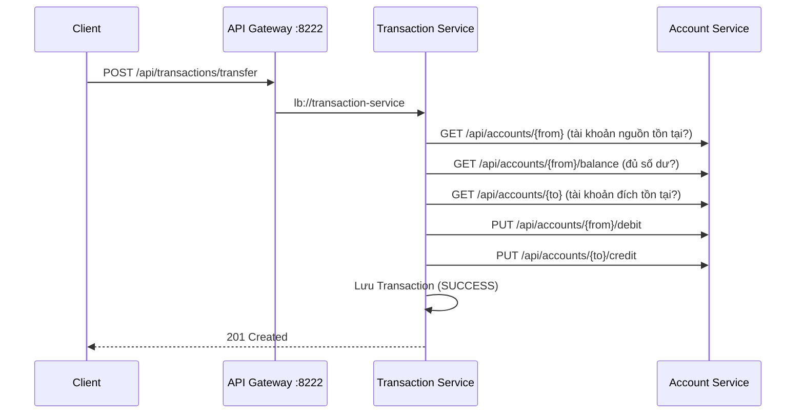

# FinBank: Giao tiếp đồng bộ giữa các Microservice bằng RestTemplate

Bài tập tổng hợp 3 (Session 07): xây dựng nghiệp vụ **chuyển tiền** trong đó Transaction Service gọi sang Account Service bằng `RestTemplate` + `@LoadBalanced` (gọi qua tên service đăng ký trên Eureka). Mọi request từ client đi qua API Gateway (port 8222).

## Kiến trúc

| Module | Port | Vai trò |
|--------|------|---------|
| `eureka-server` | 8761 | Service Registry: các service đăng ký và tra cứu nhau theo tên |
| `api-gateway` | 8222 | Cổng vào duy nhất, định tuyến `/api/accounts/**` và `/api/transactions/**` qua `lb://<tên-service>` |
| `account-service` | 8081 | Quản lý tài khoản, số dư, trừ/cộng tiền (H2 `accountdb`) |
| `transaction-service` | 8082 | Nhận yêu cầu chuyển tiền, gọi Account Service, lưu giao dịch (H2 `transactiondb`) |

```
Client (Postman)
      │  http://localhost:8222
      ▼
 API Gateway ──lb://transaction-service──▶ Transaction Service
      │                                         │ RestTemplate @LoadBalanced
      └──────lb://account-service──────▶ Account Service ◀─┘  http://account-service/api/accounts/...
                          ▲
                Eureka Server (8761): tra cứu địa chỉ theo tên service
```

**Công nghệ:** Java 17, Spring Boot 3.2.3, Spring Cloud 2023.0.0 (Netflix Eureka, Gateway, LoadBalancer), Spring Data JPA, H2 in-memory.

## Cấu trúc thư mục

```
homework-session_07-ex3/
├── pom.xml                      # parent pom (Spring Boot + Spring Cloud BOM)
├── mvnw, mvnw.cmd, .mvn/        # Maven Wrapper
├── eureka-server/
├── api-gateway/
├── account-service/
│   └── src/main/java/com/finbank/account/
│       ├── controller/AccountController.java
│       ├── service/AccountService.java
│       ├── entity/Account.java, repository/AccountRepository.java
│       ├── dto/…, exception/…   # GlobalExceptionHandler trả lỗi dạng JSON
├── transaction-service/
│   └── src/main/java/com/finbank/transaction/
│       ├── config/AppConfig.java          # Bean RestTemplate @LoadBalanced
│       ├── client/AccountClient.java      # Gọi Account Service bằng RestTemplate
│       ├── service/TransferService.java   # Luồng chuyển tiền
│       ├── controller/TransactionController.java
│       ├── entity/Transaction.java, TransactionStatus.java
│       └── dto/…, exception/…
└── postman/FinBank-Transfer.postman_collection.json
```

## API

### Account Service (Yêu cầu 1)

| Method | Endpoint | Mô tả |
|--------|----------|-------|
| `POST` | `/api/accounts` | Tạo tài khoản: `{ "accountNumber", "ownerName", "balance" }` |
| `GET` | `/api/accounts` | Danh sách tài khoản |
| `GET` | `/api/accounts/{accountNumber}` | Lấy thông tin tài khoản theo số tài khoản |
| `GET` | `/api/accounts/{accountNumber}/balance` | Lấy số dư: `{ "accountNumber", "balance" }` |
| `PUT` | `/api/accounts/{accountNumber}/debit` | Trừ tiền, body `{ "amount": 100000 }` |
| `PUT` | `/api/accounts/{accountNumber}/credit` | Cộng tiền, body `{ "amount": 100000 }` |

Lỗi trả về JSON `{ timestamp, status, error, message, path }`:

| Trường hợp | HTTP |
|---|---|
| Không tìm thấy tài khoản | 404 |
| Trừ tiền vượt số dư | 400 |
| Số tài khoản đã tồn tại | 409 |
| Dữ liệu không hợp lệ (`amount <= 0`, thiếu trường…) | 400 |

`debit`/`credit` dùng khóa dòng (`PESSIMISTIC_WRITE`) và `debit` kiểm tra lại số dư ngay trong transaction, nên hai request đồng thời không thể làm số dư âm.

### Transaction Service (Yêu cầu 3)

| Method | Endpoint | Mô tả |
|--------|----------|-------|
| `POST` | `/api/transactions/transfer` | Chuyển tiền |
| `GET` | `/api/transactions` | Lịch sử giao dịch (cả SUCCESS và FAILED) |
| `GET` | `/api/transactions/{id}` | Chi tiết một giao dịch |

Request body:

```json
{
    "fromAccountNumber": "1001",
    "toAccountNumber": "1002",
    "amount": 2000000,
    "description": "Chuyển tiền thanh toán hóa đơn"
}
```

Response luôn là bản ghi giao dịch đã lưu (kể cả khi thất bại), kèm `status` và `message`:

```json
{
    "id": 1,
    "fromAccountNumber": "1001",
    "toAccountNumber": "1002",
    "amount": 2000000,
    "description": "Chuyển tiền thanh toán hóa đơn",
    "status": "SUCCESS",
    "message": "Chuyển tiền thành công",
    "createdAt": "2026-10-08T22:17:49.3890818"
}
```

## Cấu hình RestTemplate (Yêu cầu 2)

[`AppConfig.java`](transaction-service/src/main/java/com/finbank/transaction/config/AppConfig.java):

```java
@Bean
@LoadBalanced
public RestTemplate restTemplate(RestTemplateBuilder builder, ...) {
    return builder
            .setConnectTimeout(connectTimeout)   // 3s
            .setReadTimeout(readTimeout)         // 5s
            .build();
}
```

- `@LoadBalanced` cho phép dùng URL `http://account-service/api/accounts/...`. Spring Cloud LoadBalancer hỏi Eureka danh sách instance của `account-service` rồi thay tên service bằng `host:port` thật. Không hard-code `localhost:8081`.
- Timeout để request không bị treo vô hạn khi Account Service không phản hồi (cấu hình trong `application.yml`, khóa `account-service.connect-timeout` / `read-timeout`).

## Luồng chuyển tiền

Xử lý trong [`TransferService.transfer()`](transaction-service/src/main/java/com/finbank/transaction/service/TransferService.java):



1. **Bước 1:** nhận và validate request (`fromAccountNumber`, `toAccountNumber`, `amount > 0`); tài khoản nguồn và đích không được trùng nhau.
2. **Bước 2:** gọi `GET /api/accounts/{from}` và `GET /api/accounts/{from}/balance`. Nếu tài khoản không tồn tại hoặc số dư < `amount` thì dừng.
3. **Bước 3:** gọi `GET /api/accounts/{to}`. Nếu tài khoản đích không tồn tại thì dừng.
4. **Bước 4:** gọi `PUT .../{from}/debit` rồi `PUT .../{to}/credit`. Nếu cộng tiền đích thất bại sau khi đã trừ tiền nguồn, service **hoàn tiền** (credit lại tài khoản nguồn) để tiền không bị mất.
5. **Bước 5:** lưu bản ghi vào bảng `transactions` với `status = SUCCESS`. Ở bất kỳ bước nào bị lỗi, bản ghi vẫn được lưu với `status = FAILED` và `message` là lý do.

### Xử lý lỗi khi gọi Account Service

[`AccountClient`](transaction-service/src/main/java/com/finbank/transaction/client/AccountClient.java) chuyển các exception của RestTemplate thành thông báo rõ ràng:

| Lỗi từ RestTemplate | Nguyên nhân | HTTP trả về client | `message` |
|---|---|---|---|
| `HttpClientErrorException.NotFound` | Tài khoản không tồn tại | 404 | `Không tìm thấy tài khoản 9999` |
| `HttpClientErrorException` (400) | Ví dụ debit vượt số dư | 400 | Lấy từ body lỗi của Account Service |
| `ResourceAccessException` | Không kết nối được / quá timeout | 503 | `Account Service không phản hồi, vui lòng thử lại sau` |
| `HttpServerErrorException` (5xx) | Account Service lỗi nội bộ | 503 | `Account Service gặp lỗi, vui lòng thử lại sau` |
| `IllegalStateException` | Eureka không có instance nào của `account-service` | 503 | `Account Service hiện không khả dụng, vui lòng thử lại sau` |

## Cách chạy

Yêu cầu: JDK 17. Không cần cài Maven (dùng Maven Wrapper) và không cần cài database (H2 in-memory).

```bash
# Build tất cả module
./mvnw clean package -DskipTests        # Windows: mvnw.cmd clean package -DskipTests

# Chạy mỗi service trong một terminal riêng, theo thứ tự:
java -jar eureka-server/target/eureka-server-1.0.0.jar
java -jar account-service/target/account-service-1.0.0.jar
java -jar transaction-service/target/transaction-service-1.0.0.jar
java -jar api-gateway/target/api-gateway-1.0.0.jar
```

Kiểm tra trên Eureka Dashboard http://localhost:8761: phải thấy `ACCOUNT-SERVICE`, `TRANSACTION-SERVICE`, `API-GATEWAY`. Sau khi service đăng ký, Gateway có thể cần khoảng 30 giây để cập nhật danh sách. Trong thời gian đó request qua Gateway có thể trả về 503.

> Dữ liệu H2 nằm trong bộ nhớ nên sẽ mất khi tắt service. Xem dữ liệu tại http://localhost:8081/h2-console (JDBC URL `jdbc:h2:mem:accountdb`) và http://localhost:8082/h2-console (`jdbc:h2:mem:transactiondb`), user `sa`, không mật khẩu.

## Cách test (Yêu cầu 4)

1. Mở Postman → **Import** → chọn [`postman/FinBank-Transfer.postman_collection.json`](postman/FinBank-Transfer.postman_collection.json).
2. Biến `baseUrl` của collection = `http://localhost:8222`, nên tất cả request đi qua API Gateway.
3. Chạy cả collection bằng **Run collection** (Collection Runner) theo thứ tự, hoặc gửi từng request:

| Thư mục | Request | Kết quả mong đợi |
|---|---|---|
| 1. Tạo dữ liệu | Tạo `1001` (10,000,000) và `1002` (5,000,000) | `201 Created` (`409` nếu đã tạo trước đó) |
| 2. Account Service API | GET tài khoản, GET số dư, PUT debit/credit, GET `9999` | `200`; `404` cho `9999` |
| 3. Test case 1 | Chuyển 2,000,000 từ `1001` → `1002` | `201`, `status: SUCCESS`; số dư `1001` giảm 2,000,000, `1002` tăng 2,000,000 |
| 4. Test case 2 | Chuyển 100,000,000 từ `1001` → `1002` | `400`, `status: FAILED`, message báo không đủ số dư |
| 5. Test case 3 | Chuyển tới tài khoản `9999` | `404`, `status: FAILED`, message báo không tìm thấy tài khoản 9999 |
| 6. Lịch sử giao dịch | GET `/api/transactions` | Có cả giao dịch `SUCCESS` và `FAILED` |

Mỗi request đều có test script kiểm tra tự động status code, trạng thái giao dịch và số dư trước/sau.

## Kết quả kiểm thử

Chạy collection bằng Newman (Postman CLI) trên dữ liệu mới: **15 request, 22 assertion, 0 lỗi**. Chạy lại lần 2 (không khởi động lại service) cũng đạt 22/22.

Response thực tế qua Gateway (port 8222):

**Test case 1: thành công**

```
POST /api/transactions/transfer  →  201 Created
{"id":1,"fromAccountNumber":"1001","toAccountNumber":"1002","amount":2000000,
 "description":"Chuyển tiền thanh toán hóa đơn","status":"SUCCESS",
 "message":"Chuyển tiền thành công","createdAt":"2026-10-08T22:17:49.3890818"}

GET /api/accounts/1001/balance  →  {"accountNumber":"1001","balance":8000000.00}
GET /api/accounts/1002/balance  →  {"accountNumber":"1002","balance":7000000.00}
```

**Test case 2: không đủ số dư**

```
POST /api/transactions/transfer  →  400 Bad Request
{"id":2,"fromAccountNumber":"1001","toAccountNumber":"1002","amount":100000000,
 "description":"Chuyển số tiền vượt số dư","status":"FAILED",
 "message":"Tài khoản 1001 không đủ số dư (số dư: 8000000.00, cần: 100000000)", ...}
```

**Test case 3: tài khoản đích không tồn tại**

```
POST /api/transactions/transfer  →  404 Not Found
{"id":3,"fromAccountNumber":"1001","toAccountNumber":"9999","amount":500000,
 "description":"Chuyển tới tài khoản không tồn tại","status":"FAILED",
 "message":"Không tìm thấy tài khoản 9999", ...}
```

Sau test case 2 và 3, số dư hai tài khoản giữ nguyên (8,000,000 và 7,000,000).

**Thêm: Account Service không phản hồi.** Tắt Account Service rồi gửi lệnh chuyển tiền:

```
POST /api/transactions/transfer  →  503 Service Unavailable
{"id":4, ..., "status":"FAILED","message":"Account Service không phản hồi, vui lòng thử lại sau", ...}
```

Log của Transaction Service cho thấy URL `http://account-service/...` đã được LoadBalancer phân giải qua Eureka thành địa chỉ thật của instance:

```
Khong goi duoc Account Service: I/O error on GET request for "http://account-service/api/accounts/1001":
Connect to http://192.168.1.11:8081 [/192.168.1.11] failed: Connection refused
```
